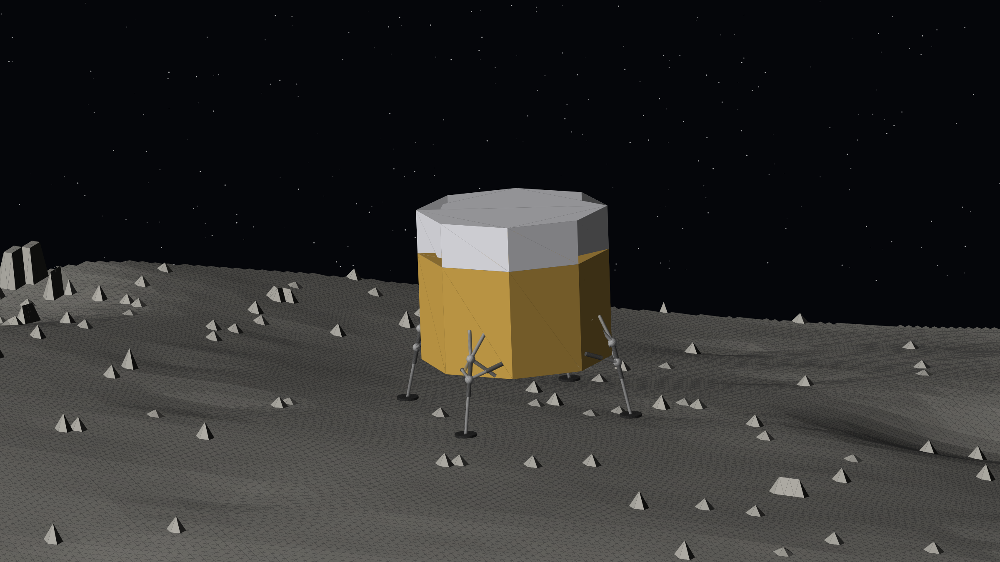
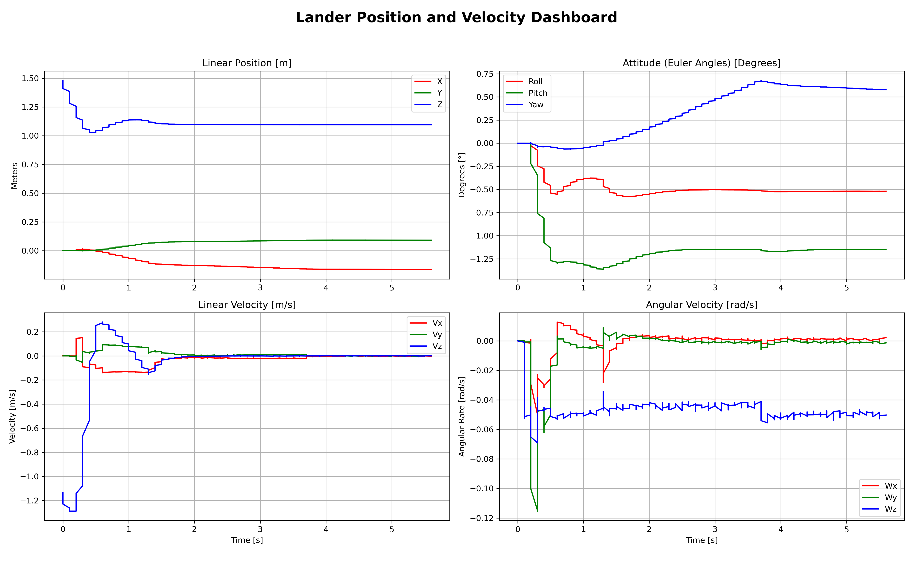
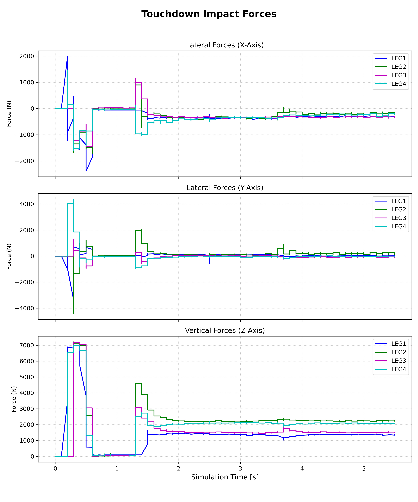
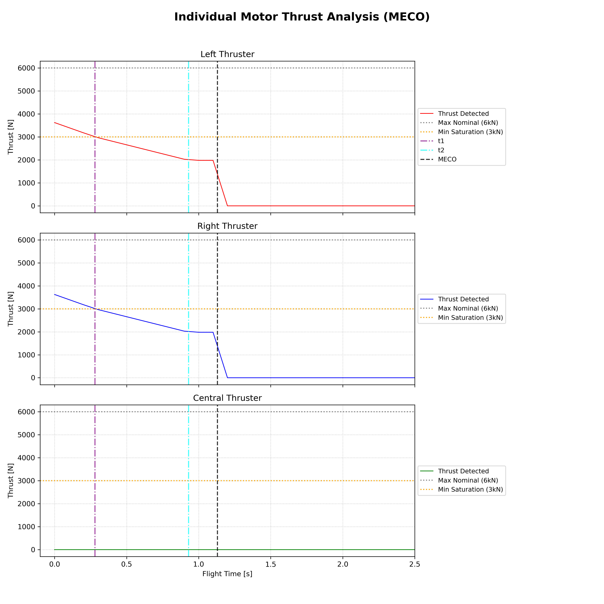
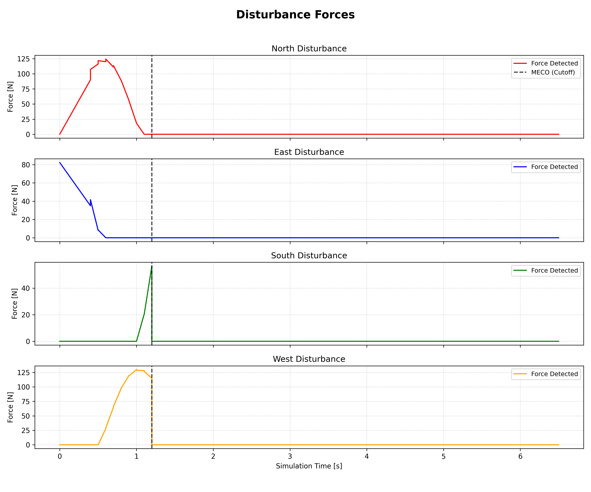
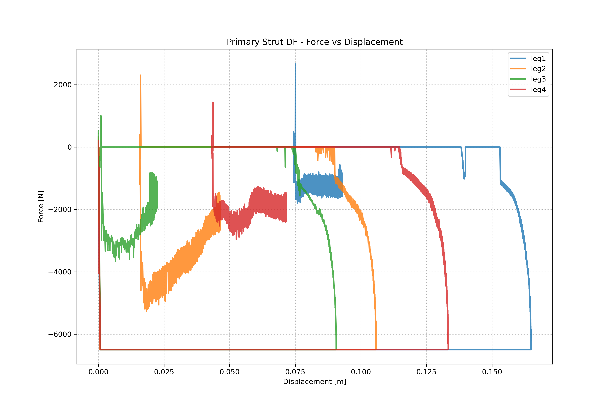
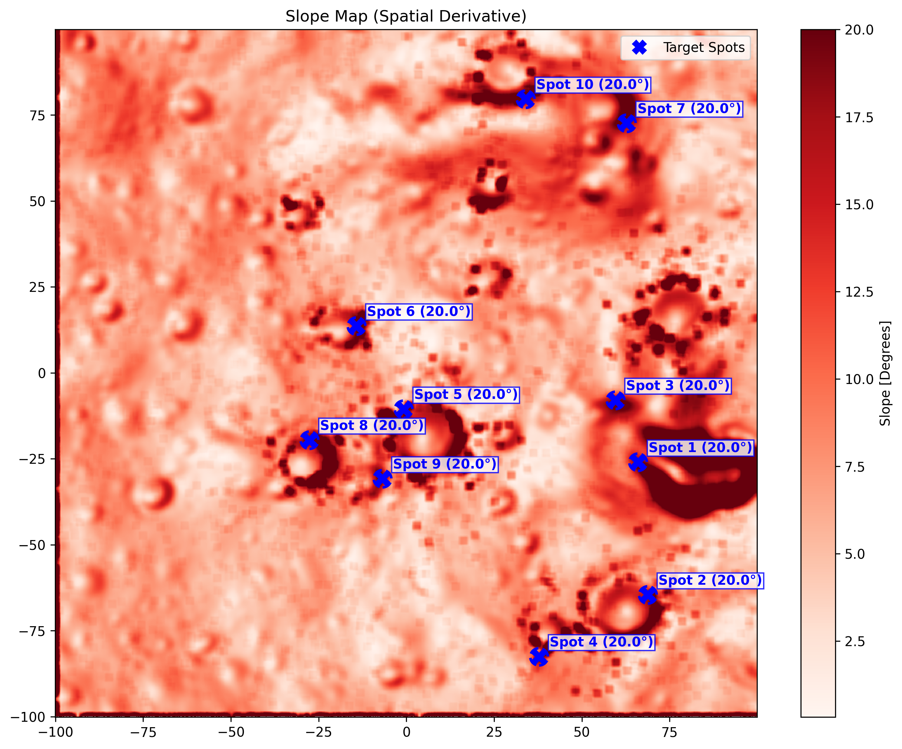
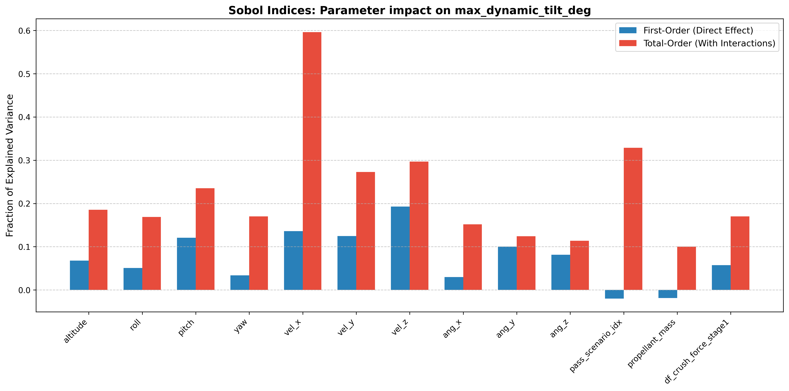

<div align="center">

# 🌑 Lander-Sim · Touchdown Simulator

**A physics-based simulator of the final landing and touchdown phase of a lunar lander, built on ROS 2 Humble and Gazebo Classic.**




<sub><i>The generated lander model above a cropped patch of lunar terrain, at its scenario spawn pose (rendered from the simulator's SDF and STL assets).</i></sub>

</div>

---

## Contents

- [What is it?](#what-is-it)
- [What gets simulated](#what-gets-simulated)
- [How a run works](#how-a-run-works)
- [Getting started: step by step](#getting-started-step-by-step)
- [Configuration reference](#configuration-reference)
- [Outputs](#outputs)
- [Sensitivity analysis (advanced)](#sensitivity-analysis-advanced)
- [Repository layout](#repository-layout)
- [ROS topics](#ros-topics)
- [Troubleshooting](#troubleshooting)

---

## What is it?

Lander-Sim simulates the **last few seconds of a lunar landing**: the lander hovers a short distance above the ground, the main engines throttle down and cut off, and the vehicle drops onto real lunar terrain. The simulator then follows the impact, how the landing-leg shock absorbers crush and rebound, and how the vehicle settles, until it comes to rest or tips over.

It answers questions such as:

- Does the lander stay upright on a given slope, rock field or crater rim?
- What loads do the legs see at touchdown, and how much do the shock absorbers stroke?
- Does the hull or an engine nozzle hit the ground?
- Which parameters matter most for stability? Initial velocity, attitude, mass distribution or absorber tuning?

Two workflows are provided:

| Workflow | Config file | What it does |
|---|---|---|
| **Single simulation** | `cfg/single_simulation.yaml` | One deterministic scenario with fixed values. Optional Gazebo GUI. |
| **Monte Carlo campaign** | `cfg/multiple_simulations.yaml` | N headless runs, each sampling its own scenario from configured ranges. One CSV row per run. |

---

## What gets simulated

### 🛰️ The lander, generated from the YAML for every run

| Component | Model |
|---|---|
| **Body** | Octagonal structure with four propellant tanks (MON oxidiser / MMH fuel, in a configurable mixture ratio). The **landing mass** sets the propellant load; mass, centre of gravity and inertia tensor are computed from the tank geometry plus a selectable *dry-mass scenario*. |
| **Passenger / payload module** | Mounted on top of the body, with its own mass, CoG and inertia picked from a list of *passenger scenarios*. |
| **4 landing legs** | Each leg is a truss with a **primary strut (D–F)**, which holds a two-stage **crushable shock absorber**, and two **secondary struts (B–E)**, each with its own absorber. Every leg ends in a compliant **footpad**. |
| **Main engines** | 1, 2 or 3 engines (central / left + right / all three). |

### ⚙️ Physics and custom Gazebo plugins (C++)

| Plugin | Role |
|---|---|
| `CrushableJointPlugin` | Shock-absorber model: spring–damper plus **two crush stages** (constant crush force up to a stroke limit, then a higher one), a **bottom-out** stiffness at full stroke, and separate **rebound damping**. Publishes force against displacement for each leg. |
| `DynamicTerrainPlugin` | Contact properties that depend on penetration depth. Shallow contact behaves like **regolith dust** (soft, low friction). As the foot sinks past the dust thickness, contact blends toward **rock** (stiff, high friction). |
| `gazebo_ros_thruster` | Applies the commanded thrust (ROS topic) as a force on the body link. |
| `InitialVelocityPlugin` | Gives the lander its initial linear and angular velocity at spawn. |

Gravity is lunar (**1.625 m/s²**) and Gazebo runs the **ODE** physics engine.

### 🔥 Engine cutoff profile

The `thrusters_node` reads the generated masses, computes the hover thrust `T₀ = m·g` and the matching throttle, and then runs a scripted **throttle-down and cutoff (MECO)** sequence:

```
throttle
 100% ┐
      │ ╲            linear ramp to 50 % (t = 1.35 s)
  50% ┤   ╲___
  33% ┤       ╲____  ramp to 33 % (t = 2.0 s), hold until 2.2 s
   0% ┤            └──────────  engines off
      └──────────────────────────── t
```

### 🌪️ Plume–surface interaction disturbance

The `psi_disturbance_node` imitates the lateral push of engine plume interacting with the ground. Below **10 m** of true altitude (measured against the terrain mesh, not z = 0), it applies a lateral force that grows quadratically as the lander descends, capped at **500 N**. The force rotates through North / East / South / West and switches off at engine cutoff.

### 🏔️ Terrain

Lunar terrain meshes (STL) sit in `src/worlds/models/terrain_model/meshes/`. For every run, the mesh is **cropped around the landing point** (with `crop_radius`) so Gazebo only loads the area that matters. The lander's spawn altitude is measured from the local terrain height.

---

## How a run works

```text
 cfg/*.yaml
     │
     ├──► generate_body.py      ─► body.sdf, passenger.sdf        (mass, CoG, inertia)
     ├──► generate_scenario.py  ─► landing_scenario.world,        (pose, velocities,
     │                              terrain_cropped.stl            contact params)
     └──► generate_legs.py      ─► leg1..4.sdf, lander.sdf        (geometry, absorbers)
                  │
                  ▼
     Gazebo (gzserver or GUI)  +  ROS 2 nodes
        ├─ thrusters_node          → engine throttle-down and cutoff
        ├─ psi_disturbance_node    → lateral plume disturbance
        ├─ data_logger_node        → telemetry, touchdown detection, stop logic, CSV
        ├─ df_logger_node          → shock-absorber force vs. stroke
        └─ thruster_logger_node    → thrust history, thrust at impact
                  │
                  ▼
     data/results/*.csv   +   figures/simulation/*.png
```

**Touchdown** is detected when any footpad sees a vertical contact force above 5 N.
**The run ends** when either:
- all linear and angular velocities stay below `epsilon` for `steady_req_duration` seconds (the lander has **settled**), or
- `timeout_after_touchdown` seconds have passed since touchdown.

The data logger then broadcasts a stop signal. Every node writes its data, and the whole launch shuts down by itself.

---

## Getting started: step by step

> The project runs inside Docker (ROS 2 Humble + Gazebo Classic). You need only Docker on the host. On Windows you also need an X server if you want the Gazebo GUI.

### Step 1: Install the prerequisites

- **Docker Desktop** (with Docker Compose)
- **Git**
- *(GUI only, Windows)* an X server such as **VcXsrv** or **Xming**, started with *"Disable access control"* so the container can connect

Check that Docker works:

```powershell
docker version
docker compose version
```

### Step 2: Clone the repository

```bash
git clone https://github.com/Alessandro-Scarciglia/Lander-Sim.git
cd Lander-Sim
```

### Step 3: Build and start the container

```bash
docker compose build      # first time only, takes a few minutes
docker compose up -d      # starts the "touchdown-sim" container in the background
```

`docker-compose.yml` mounts `./touchdown_ws` into the container at `/workspace/touchdown_ws`. Edits you make on the host (configs, code) appear inside the container straight away, and results written by the simulator appear on your host.

### Step 4: Open a shell inside the container

```bash
docker compose exec touchdown-sim bash
cd /workspace/touchdown_ws
```

### Step 5: Configure your landing

Open `touchdown_ws/cfg/single_simulation.yaml` (from the host or the container) and set the scenario. The most useful knobs are:

```yaml
simulation:
  headless: true          # true = no GUI, runs automatically | false = Gazebo GUI

terrain:
  mesh_file: terrain_col_light.stl   # any STL in src/worlds/models/terrain_model/meshes/
  crop_radius: 25.0

landing_scenario:
  pos_x: 0.0              # landing point on the terrain [m]
  pos_y: 0.0
  altitude: 0.255         # height above the local terrain [m]
  roll_deg: 0.0           # initial attitude [deg]
  pitch_deg: 0.0
  yaw_deg: 0.0
  vel_x: 0.0              # initial velocity [m/s]
  vel_y: 0.0
  vel_z: -1.1             # negative = descending
  ang_x_deg_s: 0.0        # initial angular rates [deg/s]
  ang_y_deg_s: 0.0
  ang_z_deg_s: 0.0
```

See the [configuration reference](#configuration-reference) for the full list.

### Step 6: Run a single simulation

```bash
bash scripts/run_simulation.sh
```

The script sources ROS 2, runs `colcon build`, regenerates the lander and world from the YAML, and launches the simulation:

- **`headless: true`**: Gazebo runs without a window and physics starts on its own. The command returns when the lander has settled.
- **`headless: false`**: the Gazebo GUI opens **paused**. Press **▶ Play** (bottom of the Gazebo window) to start the descent.

You can also start it straight from Windows PowerShell, without opening a shell in the container:

```powershell
docker compose exec touchdown-sim bash -lc "bash /workspace/touchdown_ws/scripts/run_simulation.sh"
```

### Step 7: Look at the results

When the run ends you will find:

- `touchdown_ws/data/results/single_run_YYYYMMDD_HHMMSS.csv`: one row that summarises the landing (see [Outputs](#outputs))
- `touchdown_ws/figures/simulation/01…05_*.png`: telemetry, impact-force, thrust, disturbance and shock-absorber plots

### Step 8: Run a Monte Carlo campaign

1. Open `touchdown_ws/cfg/multiple_simulations.yaml`.
2. Set the number of runs:
   ```yaml
   monte_carlo:
     num_runs: 100
   ```
3. Set the **ranges** to sample from. Each `[min, max]` pair is sampled uniformly for each run:
   ```yaml
   body_generation:
     landing_mass_range: [3300.0, 4340.0]   # plus a random dry/passenger scenario from the lists
   landing_scenario:
     pos_x_range: [-50.0, 50.0]
     vel_z_range: [-2.0, -0.2]
     roll_range_deg: [-5.0, 5.0]
     # ...
   leg_generation:
     df_k: [55000.0, 90000.0]               # absorber parameters can be ranges too
   ```
4. Launch the campaign:
   ```bash
   bash scripts/run_montecarlo.sh
   ```

Runs are executed **one after another** and always **headless**. Each run is seeded with its run ID, so the same `run_id` regenerates the same scenario. Progress is printed as each run goes:

```text
[RUN 1/100] Starting simulation cycle...
[RUN 1] Execution completed in 42.3 seconds.
...
 MONTE CARLO ORCHESTRATOR COMPLETED!
 Total scheduled runs: 100
 Completed without crashes: 100
```

All runs go into **a single CSV**, `data/results/montecarlo_run_<N>_<timestamp>.csv`, with one row per run. To keep the batch fast, per-run plots are switched off during Monte Carlo.

From PowerShell:

```powershell
docker compose exec touchdown-sim bash -lc "bash /workspace/touchdown_ws/scripts/run_montecarlo.sh"
```

### Step 9: Stop the container when you are done

```bash
docker compose down
```

---

## Configuration reference

Both YAML files share the same structure. In `single_simulation.yaml` every field is a **single value**. In `multiple_simulations.yaml`, fields named `*_range` or written as `[min, max]` are **sampled** for each run.

<details>
<summary><b>simulation / simulation_stop</b></summary>

| Key | Meaning |
|---|---|
| `headless` | `true` = gzserver only, automatic start. `false` = GUI, paused at start. |
| `epsilon` | Velocity threshold (linear and angular) for "at rest" |
| `steady_req_duration` | How long [s] the lander must stay below `epsilon` before the run ends |
| `timeout_after_touchdown` | Hard stop [s] after the first foot contact |

</details>

<details>
<summary><b>body_generation</b>: mass properties</summary>

| Key | Meaning |
|---|---|
| `landing_mass` / `landing_mass_range` | Body mass at landing [kg]. Sets the remaining propellant. |
| `tank_properties` | Tank radius, cylinder lengths, dome height, tank positions, MMH/MON densities, mixture ratio |
| `dry_scenarios` | List of `{mass, cog, I}` for the dry structure (Monte Carlo picks one at random) |
| `passenger_scenarios` | List of `{mass, cog, I}` for the top module |

</details>

<details>
<summary><b>terrain</b></summary>

| Key | Meaning |
|---|---|
| `mesh_file` | STL in `src/worlds/models/terrain_model/meshes/` (e.g. `terrain_col_light.stl`, `terrain_vis_light.stl`, `QLS2_LandingArea_R250m.stl`, `moon_0.stl`, …) |
| `crop_radius` | Radius [m] of the patch cropped around the landing point |

</details>

<details>
<summary><b>landing_scenario</b>: initial conditions and ground contact</summary>

| Key | Meaning |
|---|---|
| `pos_x`, `pos_y` | Landing point [m] |
| `altitude` | Height above the local terrain [m] |
| `roll_deg`, `pitch_deg`, `yaw_deg` | Initial attitude [deg] |
| `vel_x`, `vel_y`, `vel_z` | Initial linear velocity [m/s] |
| `ang_x_deg_s`, `ang_y_deg_s`, `ang_z_deg_s` | Initial angular rates [deg/s] (Monte Carlo: `ang_*_range`) |
| `kp_surface`, `kd_surface`, `mu_surface` | Contact stiffness, damping and friction of the **dust** layer |
| `kp_rock`, `kd_rock`, `mu_rock` | Same for **rock** |
| `dust_thickness` | Depth [m] over which contact blends from dust to rock |

</details>

<details>
<summary><b>thrusters</b></summary>

| Key | Meaning |
|---|---|
| `num_engines` | `1` (central), `2` (left + right) or `3` (all) |
| `engine_max_thrust` | Max thrust per engine [N] |
| `t_min`, `t_max` | Thrust saturation limits [N] |
| `lunar_gravity` | Used to compute the hover thrust [m/s²] |

</details>

<details>
<summary><b>leg_generation</b>: leg geometry and shock absorbers</summary>

| Key | Meaning |
|---|---|
| `point_D`, `point_F`, `point_B1`, `point_B2`, `base_points` | Leg geometry (attachment points of truss and struts) |
| `octagon_radius`, `z_legs` | Where the legs attach on the body |
| `*_mass`, `*_radius` | Masses and radii of the truss, struts, pistons, joints and foot |
| `df_k`, `df_c`, `df_fric`, `df_limit` | Primary absorber: stiffness, damping, friction, travel |
| `df_crush_force_stage1/2`, `df_stroke_limit_stage_1/2` | Two-stage crush forces [N] and stroke limits [m] |
| `df_bottomout_stiffness`, `df_rebound_damping` | End-of-stroke stiffness and rebound damping |
| `b_k`, `b_c`, `b_limit`, `be_crush_force`, `be_rebound_damping` | Secondary absorbers |
| `foot_k`, `foot_c` | Footpad compliance |

</details>

---

## Outputs

### Results CSV

Each run adds **one row** with the inputs that were used and the landing outcome:

| Group | Columns |
|---|---|
| Identity | `run_id` |
| Mass properties | `total_mass_kg`, `body_mass_kg`, `dry_mass_kg`, `passenger_mass_kg`, `legs_mass_kg`, `tot_cog_*`, `tot_i**` |
| Initial conditions | `init_x/y/z`, `init_vx/vy/vz`, `init_roll/pitch/yaw`, `init_wx/wy/wz` |
| Leg parameters | `df_k`, `df_c`, `df_crush_force_stage1/2`, `b_k`, `foot_k`, … |
| **Touchdown** | `first_touch_leg`, `impact_angle_deg`, `max_impact_vz_ms`, `specific_kin_energy`, `res_accel_z`, `impact_thrust_N` |
| **Stability** | `final_total_tilt_deg`, `max_dynamic_tilt_deg`, `settling_time_s` |
| **Loads and clearance** | `max_force_z_N`, `min_belly_clearance_m` |
| **Failure flags** | `flag_hull_crash`, `flag_thruster_crash` |
| Sanity check | `perceived_mass_kg`, `mass_error_kg`, `mass_error_pct` (mass seen by Gazebo against mass generated) |

### Figures (single runs)

<table>
<tr>
<td width="50%"><br/><sub><b>01</b>: position, attitude, linear and angular velocity</sub></td>
<td width="50%"><br/><sub><b>02</b>: X/Y/Z contact forces on each leg</sub></td>
</tr>
<tr>
<td><br/><sub><b>03</b>: engine thrust profile and cutoff</sub></td>
<td><br/><sub><b>04</b>: plume–surface disturbance forces</sub></td>
</tr>
<tr>
<td colspan="2" align="center"><br/><sub><b>05</b>: primary shock-absorber force against stroke, per leg</sub></td>
</tr>
</table>

---

## Sensitivity analysis (advanced)

Under `touchdown_ws/tools/` there are scripts for global sensitivity studies and post-processing:

| Script | Purpose |
|---|---|
| `tools/experiments/run_morris.py` | Morris screening (elementary effects) over 25 parameters: initial conditions, mass scenarios and absorber parameters |
| `tools/experiments/run_sobol.py` | Sobol variance decomposition (first, total and second order) over 13 parameters |
| `tools/analysis/analyze_morris.py`, `analyze_sobol.py` | Index plots and interaction heatmaps |
| `tools/analysis/analyze_rollover.py` | Rollover statistics on 10° / 15° / 20° slopes |
| `tools/analysis/analyze_terrain.py` | Slope map of a terrain mesh, plus automatic selection of challenging landing spots |
| `tools/analysis/crop_terrain_mesh.py` | Crops a terrain mesh for analysis |

<table>
<tr>
<td width="50%"><br/><sub>Terrain slope map with challenging target spots</sub></td>
<td width="50%"><br/><sub>Sobol indices for maximum tilt</sub></td>
</tr>
</table>

> ⚠️ These tools are not wired into the two main workflows yet. Before using them:
> - they need extra Python packages that the Docker image does not install: `pip install SALib pandas scipy`
> - the experiment runners read a base configuration `cfg/experiment_base.yaml` (or `TOUCHDOWN_BASE_CONFIG_FILE`) and write `cfg/simulation.yaml` (or `TOUCHDOWN_CONFIG_FILE`), so create those first
> - the analysis scripts expect specific CSV names in `data/results/` (e.g. `montecarlo_summary_sobol15.csv`)
>
> Run them **one at a time**, never in parallel with another simulation, because they share configuration and result files.

---

## Repository layout

```text
Lander-Sim/
├── Dockerfile                     ROS 2 Humble + Gazebo Classic + Python deps
├── docker-compose.yml             Container, display and volume settings
├── docs/                          README assets
└── touchdown_ws/
    ├── cfg/
    │   ├── single_simulation.yaml       Deterministic scenario
    │   └── multiple_simulations.yaml    Monte Carlo ranges
    ├── scripts/
    │   ├── run_simulation.sh            ▶ single run
    │   └── run_montecarlo.sh            ▶ Monte Carlo campaign
    ├── launch/
    │   ├── headless.launch.py           gzserver, physics running
    │   └── simulation.launch.py         Gazebo GUI, physics paused
    ├── src/
    │   ├── lander_py/                   Python: SDF generators, controllers, loggers
    │   ├── lander_sim/                  C++ Gazebo plugins
    │   └── worlds/                      World template, lander and terrain models
    ├── tools/
    │   ├── experiments/                 Monte Carlo, Morris and Sobol runners
    │   └── analysis/                    Post-processing and plotting
    ├── data/results/                    CSV outputs
    └── figures/                         Generated plots
```

---

## ROS topics

| Topic | Type | Publisher → Subscriber |
|---|---|---|
| `/lander/thrusters/{left,right,central}` | `Float64` | thrusters_node → thruster plugin, loggers, PSI node |
| `/lander/t_start` | `Float64` | thrusters_node → thruster_logger |
| `/lander/disturbance/{north,east,south,west}` | `Float64` | psi_disturbance_node → Gazebo |
| `/lander/contact_forces` | `ContactsState` | Gazebo → data_logger |
| `/lander/legN/df_force_displacement` | `Point` | CrushableJointPlugin → df_logger |
| `/lander/touchdown_time` | `Float64` | data_logger → thruster_logger |
| `/lander/impact_thrust` | `Float64` | thruster_logger → data_logger |
| `/lander/stop_logging` | `Bool` | data_logger → all nodes (end of run) |
| `/gazebo/model_states` | `ModelStates` | Gazebo → data_logger, PSI node |

<details>
<summary>Run a launch file by hand</summary>

```bash
export TOUCHDOWN_WS_ROOT=/workspace/touchdown_ws
export TOUCHDOWN_CONFIG_FILE=/workspace/touchdown_ws/cfg/single_simulation.yaml
source /opt/ros/humble/setup.bash
cd /workspace/touchdown_ws && colcon build && source install/setup.bash
ros2 launch launch/simulation.launch.py      # or launch/headless.launch.py
```

</details>

---

## Troubleshooting

<details>
<summary><b>The Gazebo GUI does not open</b></summary>

- Make sure your X server (VcXsrv / Xming) is running and accepts connections from Docker. Disable access control.
- Inside the container, `echo $DISPLAY` should print `host.docker.internal:0.0`.
- Headless runs (`headless: true`) need no X server at all.

</details>

<details>
<summary><b>The selected terrain is not found</b></summary>

```bash
ls /workspace/touchdown_ws/src/worlds/models/terrain_model/meshes/*.stl
grep -A3 '^terrain:' /workspace/touchdown_ws/cfg/single_simulation.yaml
```

`mesh_file` must match one of the listed files exactly.

</details>

<details>
<summary><b>The scripts fail from Windows PowerShell</b></summary>

The scripts in `scripts/` are Linux shell scripts. Run them inside the container, or wrap them in `docker compose exec touchdown-sim bash -lc "…"` as shown above.

</details>

<details>
<summary><b>A config or code change has no effect</b></summary>

The runner scripts rebuild the workspace before every launch. If you launch by hand, rebuild yourself:

```bash
source /opt/ros/humble/setup.bash
cd /workspace/touchdown_ws && colcon build && source install/setup.bash
```

</details>

<details>
<summary><b>The run never ends</b></summary>

The run ends at steady state or at `timeout_after_touchdown`, so **touchdown must happen first**. With `headless: false`, check that you pressed ▶ Play. Also check that the lander actually reaches the ground: look at `altitude` and `vel_z`.

</details>

---

<div align="center"><sub>Built with ROS 2 Humble · Gazebo Classic · Python · C++</sub></div>
